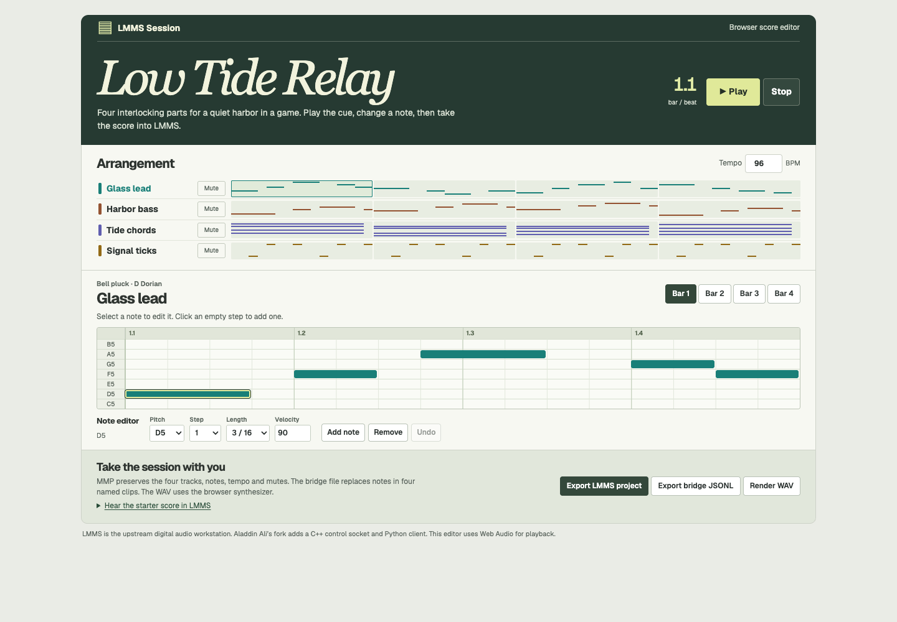

<div align="center">
	<h1>LMMS-Nebula</h1>
	<p>LMMS with a control socket, so another program can drive it while it plays</p>
	<p>An unofficial fork of <a href="https://github.com/LMMS/lmms">LMMS</a> 1.3.0-alpha.2, made for
	the music of the game Nebula Homestead</p>
</div>

## Play and edit a four-track session

[](https://naxe.dev/labs/lmms-session/)

**[Play the interactive studio](https://naxe.dev/labs/lmms-session/)** on naxe.dev. Start *Low Tide Relay*, mute the bass, or change a note in the piano roll. Export the edited session as a native LMMS song, four `set_notes` commands or a stereo WAV. The included LMMS recording lets you hear the same starter score through the desktop instruments.

[Open the session guide](nebula/session/README.md) · [Starter LMMS project](nebula/session/web/low-tide-relay.mmp) · [Native LMMS recording](nebula/session/web/low-tide-relay.ogg)

What is LMMS-Nebula?
--------------------

It is LMMS, unchanged except for one small addition: a local control socket
(`src/gui/ControlServer.cpp`). A script, or an assistant through an MCP server, can list the
tracks, move faders, play and seek, read and rewrite a clip's notes, reload a sample track's audio
after re-rendering it, and open or save the project, while you listen and edit in LMMS as usual.
The change is kept small and in LMMS's own style so it can be offered upstream.

The socket is off unless the environment variable `LMMS_CONTROL_SOCKET` names a path:

```sh
LMMS_CONTROL_SOCKET=/tmp/lmms.sock lmms song.mmp
```

Each request is one line of JSON, an object with a `cmd` and its arguments; each answer is one
line, `{"ok": true, "result": ...}` or `{"ok": false, "error": "..."}`, carrying the request's
`id` if it had one. Positions are ticks (48 to a beat) or `bar`, counted from 1; track volume is
LMMS's percent (100 = unity), pan -100 to 100, note volume 0 to 200.

| `cmd` | Arguments | Does |
|---|---|---|
| `status` | | the project, modified, loading, playing, paused, tick, bar, bpm, length |
| `tracks` | | every track: name, type, volume, pan, muted, solo, and its clips |
| `set_track` | `track`, and any of `volume`, `pan`, `muted`, `solo` | sets them on the track named |
| `play` | optional `tick` or `bar` | plays the song, from there if given |
| `pause`, `stop` | | as the transport buttons |
| `seek` | `tick` or `bar` | moves the playhead, playing or not |
| `get_notes` | `track`, and `clip` (name) or `tick`/`bar` | a MIDI clip's notes: pos, len, key, vol, pan |
| `set_notes` | as `get_notes`, and `notes` | replaces the clip's notes (all checked first) |
| `reload_samples` | `track`, optional `file`, `clip`, `tick`/`bar` | re-reads the sample clips' audio from disk |
| `open` | `path`, optional `discard_changes` | opens a project; refuses over unsaved changes |
| `save` | optional `path` | saves the project |

```sh
printf '{"cmd":"set_track","track":"Bass","volume":80}\n' | nc -U /tmp/lmms.sock
```

Requests run on the GUI thread, exactly like the user's own actions, and sample buffers are
swapped under the audio engine's lock. Only the user who started LMMS can connect.

`nebula/` has the rest:

- `control.py`, a client for the socket, from Python or the shell (`python3 nebula/control.py tracks`);
- `lmms_mcp.py`, an MCP server exposing the commands as tools, so an assistant such as Claude
  can drive LMMS while you listen (`claude mcp add lmms -- uv run /path/to/nebula/lmms_mcp.py`);
- `build-macos-app.sh`, which builds `~/Applications/LMMS-Nebula.app` beside a stock LMMS
  1.3.0-alpha.2, compiling only the `lmms` binary and reusing the stock bundle's plugins. Its
  launcher turns the socket on and gives the app settings of its own.

Elsewhere the branch builds as LMMS does (`.github/workflows/build.yml`); start LMMS with
`LMMS_CONTROL_SOCKET` set. LMMS-Nebula is free
software under the GPL, version 2 or later, like LMMS (see `LICENSE.txt`); the work in it is
LMMS's, by its many contributors.

The rest of this file is LMMS's own README.

---

<div align="center">
	<h1>
	<br>LMMS
	</h1>
	<p>Cross-platform music production software</p>
	<p>
		<a href="https://lmms.io/">Website</a>
		⦁︎
		<a href="https://github.com/LMMS/lmms/releases">Releases</a>
		⦁︎
		<a href="https://github.com/LMMS/lmms/wiki">Developer wiki</a>
		⦁︎
		<a href="https://lmms.io/documentation">User manual</a>
		⦁︎
		<a href="https://lmms.io/showcase/">Showcase</a>
		⦁︎
		<a href="https://lmms.io/lsp/">Sharing platform</a>
	</p>
	<p>
		<a href="https://github.com/LMMS/lmms/actions/workflows/build.yml"></a>
		<a href="https://lmms.io/download"></a>
		<a href="https://github.com/LMMS/lmms/releases"></a>
		<a href="https://discord.gg/3sc5su7"></a>
		<a href="https://www.transifex.com/lmms/lmms/"></a>
	</p>
</div>

What is LMMS?
--------------

LMMS is an open-source cross-platform digital audio workstation designed for music production. It includes an advanced Piano Roll, Beat Sequencer, Song Editor, and Mixer for composing, arranging, and mixing music. It comes with 15+ synthesizer plugins by default, along with VST2 and SoundFont2 support.

Features
---------

* Song-Editor for arranging melodies, samples, patterns, and automation
* Pattern-Editor for creating beats and patterns
* An easy-to-use Piano-Roll for editing patterns and melodies
* A Mixer with unlimited mixer channels and arbitrary number of effects
* Many powerful instrument and effect-plugins out of the box
* Full user-defined track-based automation and computer-controlled automation sources
* Compatible with many standards such as SoundFont2, VST2 (instruments and effects), LADSPA, LV2, GUS Patches, and full MIDI support
* MIDI file importing and exporting

Building
---------

See [Compiling LMMS](https://github.com/LMMS/lmms/wiki/Compiling)

Join LMMS-development
----------------------

If you are interested in LMMS, its programming, artwork, testing, writing demo songs, (and improving this README...) or something like that, you're welcome to participate in the development of LMMS!

Information about what you can do and how can be found in the [wiki](https://github.com/LMMS/lmms/wiki).

Before coding a new big feature, please _always_ [file an issue](https://github.com/LMMS/lmms/issues/new) for your idea and suggestions about your feature and about the intended implementation on GitHub, or ask in one of the tech channels on Discord and wait for replies! Maybe there are different ideas, improvements, or hints, or maybe your feature is not welcome/needed at the moment.
